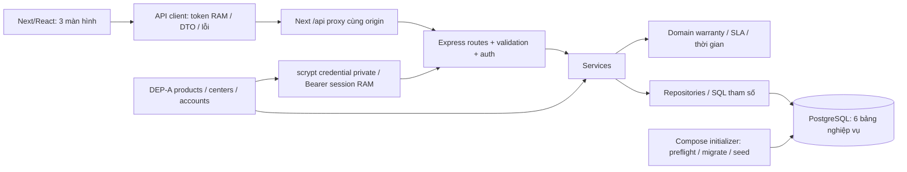

# Kiến trúc đã hiện thực — Backend Phase 6 / Frontend FE-01–04

Ngày 2026-10-25. **IMPLEMENTATION** được đối chiếu source và runtime; các DD/TECH là **DESIGN**, không phải quy định nguồn mới.

## Thành phần và đường đi thực tế

| Trách nhiệm | Vị trí |
| --- | --- |
| Route giao diện và entry | src/frontend/app/(mekong-mobile)/; l2-app.tsx chuyển tiếp về home-screen |
| Session và guard UI | src/frontend/src/components/auth/; một client trong provider của layout chung |
| Login và validation hỗ trợ UX | src/frontend/src/components/screens/login-screen.tsx; src/lib/login-validation.ts; backend vẫn kiểm A01 độc lập |
| Tiếp nhận khách hàng/thiết bị inline | src/frontend/src/components/intake/; src/lib/intake-validation.ts; E01–E05 qua API client |
| Phân loại, preview và kết quả tạo | components/intake/classification-form.tsx, warranty-preview.tsx, ticket-receipt.tsx; src/lib/ticket-validation.ts, date-time.ts |
| Khung topbar/sidebar/responsive | src/frontend/src/components/layout/app-shell.tsx, app/globals.css |
| Màn hình và form kế thừa | src/frontend/src/components/screens/, legacy/; nhãn tại src/lib/labels.ts, trạng thái tải tại src/hooks/use-remote.ts và components/ui/read-state.tsx |
| HTTP client và decoder DTO | src/frontend/src/lib/api-client.ts, contracts.ts |
| Proxy HTTP cùng origin, giữ status/body/auth; timeout | src/frontend/app/api/[...path]/route.ts |
| Composition root, auth, error envelope | src/backend/src/app.ts, server.ts, auth.ts, errors.ts |
| Routes / validator | src/backend/src/routes/, customer-device.validation.ts, ticket.validation.ts |
| Customer / Device / catalog / warranty / ticket orchestration | src/backend/src/services/ |
| Hàm thuần bảo hành/SLA/giờ địa phương | src/backend/src/domain/ |
| SQL tham số hóa, không luật phê duyệt trong repository | src/backend/src/repositories/ |
| Pool và transaction cùng PoolClient | src/backend/src/db.ts |
| Config dependency, không bảng mới | src/backend/config/reference.demo.json |
| Migration checksum / fixture v1 | src/backend/migrations/, src/backend/src/migrate.ts, seed.ts |
| Compose startup và health | compose-start.ts, healthcheck.ts, Dockerfile, compose.yaml |

Ví dụ tạo phiếu: UI thu customer/device/category/priority/description → client gửi Bearer → proxy forward → route kiểm body/quyền → ticket service khóa/recheck customer→device→category, lấy một thời điểm, domain chốt warranty/SLA → repository INSERT ticket và log cùng transaction → commit rồi response. Frontend không tính luật thay Backend. E11 khóa ticket, chỉ ghi metadata approval; E13 thêm communication, không đổi SLA/trạng thái.

CSDL có customer/device/issue_category/ticket/ticket_status_log/ticket_communication và bảng **kỹ thuật** schema_migration. Không có bảng session/product/account mới. DEP-A là dependency tối thiểu đã duyệt; dữ liệu khách/phiếu thật nằm PostgreSQL.

## Authentication và ranh giới

Login server kiểm scrypt private, trả principal và random Bearer. Client lưu token trong closure RAM, không localStorage/sessionStorage. 401 xóa phiên và về login; refresh mất phiên; restart Backend làm token cũ hết hiệu lực. UI hiển thị theo role, server kiểm role/center từ principal trên từng request. QL đọc trao đổi, không được E13. Prototype HTTP loopback không thay thế hệ thống auth production.

FE-01 giữ provider ở layout route group, chuyển trang bằng Next Link/router nên phiên RAM tồn tại qua các trang. Client gắn version phiên cho request và kiểm trước/sau đọc response body; request/login cũ sau logout hoặc đổi token bị từ chối bằng lỗi client STALE_REQUEST. 401 của A01 không gọi xử lý hết phiên. Guard không render child riêng khi thiếu phiên hoặc sai role; kiểm quyền bắt buộc vẫn ở Express. Logout không thu hồi token tại server vì contract chưa có API này.

FE-02 thêm validation thuần cho form login: đếm code point sau trim username, giữ nguyên password, chặn NUL/Unicode không hợp lệ. Không import validator/backend private vào frontend. Form dùng ref chặn gửi lặp ngay trong cùng lượt sự kiện, state hiển thị busy, label/aria/lỗi/focus và hiện/ẩn mật khẩu. Lỗi400 gắn field,401 dùng thông báo chung,503 đầy session tách khỏi lỗi kết nối; retry chỉ từ thao tác người dùng. Provider/client/guard của FE-01 và API A01 không đổi.

FE-03 tách CustomerSection/DeviceSection/ProductPicker: khách hàng và thiết bị cùng màn hình, raw phone tách khỏi phone masked, E03/E05 phân trang theo metadata. Validation frontend chỉ hỗ trợ nhập; server giữ chuẩn hóa/UNIQUE/scope/owner/tháng bảo hành/ngày tương lai. Client decode `existing_device` trong409 đúng mã; không suy hồ sơ ngoài quyền. Generation/ref loại kết quả cũ sau đổi số/khách; phiên bản lựa chọn remount vùng phân loại để xóa draft/preview cũ. POST mất phản hồi không tự gửi lại: E02 phục hồi qua lookup phone, E04 qua serial exact của customer.

FE-04 thay form intake kế thừa bằng ClassificationForm: E06/E07 tải và retry độc lập, validation mô tả/code point/nhóm/ưu tiên, summary không tự tính ngày/hạn. Parent quản lý draft/submitting/uncertain/created, ref khóa tức thời và fieldset khóa khách/thiết bị trong POST. Sau201 thay form bằng TicketReceipt từ response E08; chỉ mở detail khi người dùng chọn. Trước ID mà timeout/mạng/DTO lỗi có thể đã commit: giữ draft khóa, không tự POST lại. Hủy draft có xác nhận, không xóa dữ liệu E02/E04 đã lưu. Timestamp trình bày tại Asia/Ho_Chi_Minh và giữ ISO gốc trong thuộc tính time.

Các route UI hiện có: `/login`, `/intake`, `/tickets`, `/tickets/[ticketId]`. QL có hàng chờ E09, NV chỉ mở ID và không gọi E09; QL không có link intake. Không thêm endpoint nghiệp vụ. Danh sách/chi tiết/phê duyệt/trao đổi tiếp tục theo FE-05/06 trong [kế hoạch frontend](plans/frontend-l2-implementation-plan.md).

Proxy chỉ chuyển đường dẫn đã allowlist, không có luật/SQL/secret và không phải endpoint nghiệp vụ mới. L2_API_PROXY_TARGET chỉ ở Next server; public base mặc định /api. Chỉ triển khai ba màn hình, không bộ UI CRUD đầy đủ.

## Tái lập

Local chạy hai tiến trình dev theo root README. Compose có database/backend/frontend, publish HTTP loopback, database chỉ mạng nội bộ và volume riêng. Mode local chỉ chấp nhận DB host loopback; mode compose chỉ host database; cả hai chỉ tên mekong-mobile-l2. Initializer khóa advisory toàn chuỗi credential/migrate/seed, không chạy server khi lỗi; health xác minh checksum/config/DB và HTTP 401. Backend image chạy user node. Credential mới chỉ trong volume private; dùng lại khi restart. Seed lặp không ghi đè dữ liệu vận hành.

Helper backend `scripts/ui-test.ts` hỗ trợ catalog hơn100 sản phẩm/catalog rỗng (FE-03), clock nghiệp vụ và nhóm ngừng (FE-04) chỉ trong fixture/schema cách ly. Clock truyền qua dependency sẵn có của warranty/device/ticket service; không đổi auth clock hay thêm endpoint chỉnh giờ. Restart test khôi phục clock/catalog, giữ fingerprint public trước/sau và dọn đúng schema test. Không đổi backend production/config/seed/migration.

Giới hạn: session một process, reference config offline, chưa cloud/HA/monitoring/refresh token. Wireframe được thích ứng theo TD-13/TD-15/TD-17/TD-18, không sửa PDF/contract/SRS gốc. FE-01–04 đã hiện thực; FE-05–07 và thị giác toàn bộ còn theo kế hoạch. Xem [README](../README.md), [minh chứng Phase 6](tests/bt2-test-evidence.md), [Phase 6](progress/backend/phase-06.md) và [FE-04](progress/frontend/phase-04.md).
